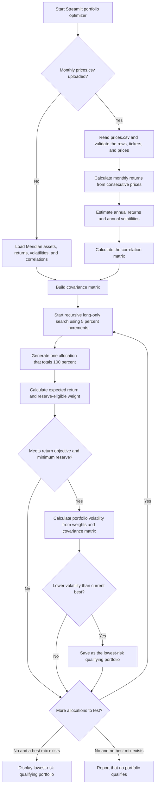

# Lab 15 — Portfolio Stability

## Lab 15 — Portfolio Engine Flowchart

## Historical Price Data

The [prices.csv](prices.csv) file contains month-end, adjusted closing prices for all four ETFs. Each observation uses the last trading day of the month; all four series share the same 60 monthly dates.

| ETF | Role | Source |
|---|---|---|
| SGOV | Short-term Treasury securities | [Yahoo Finance — SGOV historical data](https://finance.yahoo.com/quote/SGOV/history/) |
| TLT | Long-term Treasury bonds | [Yahoo Finance — TLT historical data](https://finance.yahoo.com/quote/TLT/history/) |
| VCIT | Investment-grade corporate bonds | [Yahoo Finance — VCIT historical data](https://finance.yahoo.com/quote/VCIT/history/) |
| SPY | U.S. stocks | [Yahoo Finance — SPY historical data](https://finance.yahoo.com/quote/SPY/history/) |

- Download date: October 22, 2026.
- Date range: October 29, 2021 through September 30, 2026.
- Frequency: monthly, using each month’s last trading day.
- Return calculations based on these historical adjusted closing prices are estimates, not forecasts or guarantees.

## Project 2 — All Months vs. Last 36 Months

| Estimation window | SGOV | TLT | VCIT | SPY | Expected return (estimate) | Volatility | Reserve eligible |
|---|---:|---:|---:|---:|---:|---:|---:|
| All months | 70% | 0% | 0% | 30% | 6.52% | 4.76% | 70% |
| Last 36 months | 85% | 0% | 0% | 15% | 6.99% | 1.91% | 85% |

The largest weight change is 15 percentage points. When the estimation window changed to the last 36 months, the optimizer increased SGOV by 15 percentage points and decreased SPY by 15 percentage points. This shows that the selected portfolio is sensitive to the historical estimates used. Expected returns are estimates based on historical data, not guaranteed future performance.

## Partner Attack — Lab 15

My partner lowered the portfolio return objective from 6.5% to 6.0%, while keeping the 3% reserve requirement and using the last 36 months of data.

| Portfolio | SGOV | TLT | VCIT | SPY | Expected return | Volatility | Reserve eligible |
|---|---:|---:|---:|---:|---:|---:|---:|
| Lowest-risk mix at 6.0% objective | 90% | 0% | 0% | 10% | 6.14% | 1.29% | 90% |
| App comparison baseline at 6.0% objective | 75% | 0% | 0% | 25% | 6.06% | 3.99% | 75% |

Largest weight change shown: 15 percentage points.

Lowering the return objective allowed the optimizer to hold more SGOV and less SPY, reducing portfolio risk. This shows that the portfolio recommendation is sensitive to changes in the client's return objective.

My partner changed the objective, not an individual asset's expected return estimate. This is a constraint sensitivity test rather than the exact estimate-change test requested in the lab.

### Estimate-Change Test

My partner changed SGOV's expected annual return to 5.14% while the app used a 6.5% return objective, a 3% minimum reserve requirement, and the last 36 months of historical data.

| Portfolio | SGOV | TLT | VCIT | SPY | Expected return | Volatility | Reserve eligible |
|---|---:|---:|---:|---:|---:|---:|---:|
| Lowest-risk mix after SGOV estimate change | 90% | 0% | 0% | 10% | 6.77% | 1.29% | 90% |
| App all-months baseline | 70% | 0% | 0% | 30% | — | — | — |

Largest weight difference shown: 20 percentage points.

Changing SGOV's expected return to 5.14% resulted in a lowest-risk mix of 90% SGOV and 10% SPY, showing that an estimate change can affect the recommended allocation. This shows estimation risk because the 20-point comparison also reflects the different historical estimation window, so it does not isolate the effect of changing SGOV's return.

## Final Decision — Adopt, Pilot, or Reject

**Decision: PILOT.** I would pilot this portfolio rather than fully adopt it. Using all months gave 70% SGOV and 30% SPY, with a 6.52% estimated return and 4.76% volatility; using the last 36 months gave 85% SGOV and 15% SPY, with a 6.99% estimated return and 1.91% volatility. The 15-percentage-point allocation change shows that the recommendation is sensitive to the historical data used. I would consider adopting it only after checking that the estimates remain stable with updated data and confirming that the portfolio meets all applicable mandate requirements.

### Reflection

An optimizer chooses the lowest-risk mix that still meets its rules. When expected returns, volatility, or correlations change, a different mix can become the lowest-risk eligible choice, so even a small input change can cause a large allocation change.

## Final Decision and Reflection

**Decision: PILOT.** I would pilot this portfolio rather than fully adopt it. The all-months portfolio allocated 70% to SGOV and 30% to SPY, while the last-36-months portfolio allocated 85% to SGOV and 15% to SPY. This 15-percentage-point change shows that the optimizer is sensitive to the historical estimates used. I would consider adopting the portfolio only after confirming that the estimates remain stable with updated data and that all applicable mandate requirements are satisfied.

Small changes in expected returns can cause large allocation changes because the optimizer selects the lowest-risk mix that still meets the return objective. When an input changes, a different portfolio can become the lowest-risk eligible choice.

